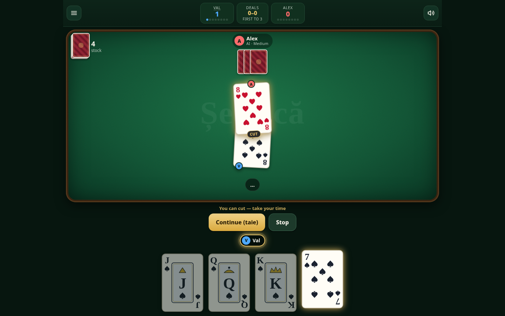
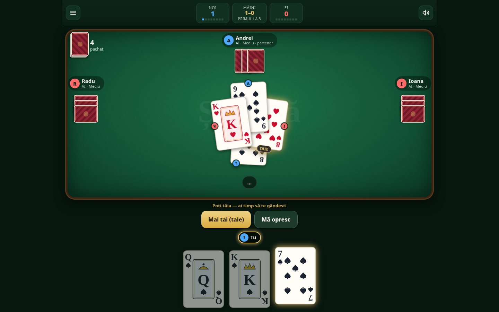

# Șeptică — by Val, VA3FOD

Șeptică is a traditional Romanian trick-taking card game. This is a single-file web version you can play in any browser, on your phone or desktop, including offline.

[Play now on GitHub Pages](https://va3fod.github.io/Septica/)

## Features

- **2-player** and **4-player teams** versus AI
- **Easy**, **Medium**, and **Hard** AI
- **English** and **Romanian**
- Rename yourself
- **Continue / Stop** when you can cut
- Last-card auto-play
- Match-win cheers
- **Piele** celebration (a clean sweep of every card in the deal): beer cheers plus a plate of mici
- Works **offline** in any browser, on phone and desktop

## How to play

- Open the game in your browser: [https://va3fod.github.io/Septica/](https://va3fod.github.io/Septica/)
- Or download [`index.html`](./index.html) and open it locally — no install, and no internet needed after that.

A copy of the v1.6 build is also attached to the [v1.6 release](https://github.com/va3fod/Septica/releases/tag/v1.6) as `Septica_v1.6.html`.

## Screenshots

2-player, English UI — you can cut, so Continue / Stop is offered:

4-player teams, Romanian UI:

Match-win cheers:

Piele — taking every card in the deal:

## Brief rules

Șeptică uses a 32-card deck (7 through Ace in four suits). Players play cards into a trick.

- You may play any card from your hand.
- A card **cuts** when it matches the rank just played, or when it is a **7**. Sevens cut anything, except when a 7 was led — then only another 7 cuts.
- The **last player to cut** takes the trick.
- If an opponent just cut and you can cut again, you may **Continue** (play another cutting card) or **Stop** and let them take the trick.
- **10s and Aces** are the point cards (1 point each). There are 8 points in a deal.
- The player or team with more points wins the deal. First to the match target wins the match.

## Credit

Made by Val, VA3FOD.

## Source and rights

The source code for this game is not published. This repository contains only the protected v1.6 build and this README. All rights reserved.
