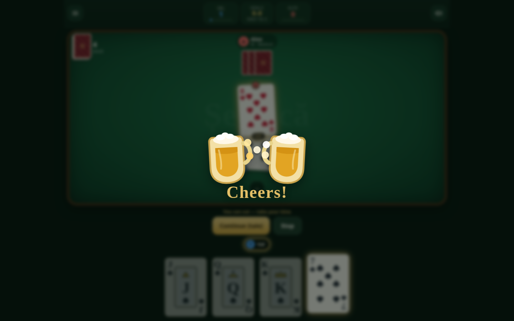
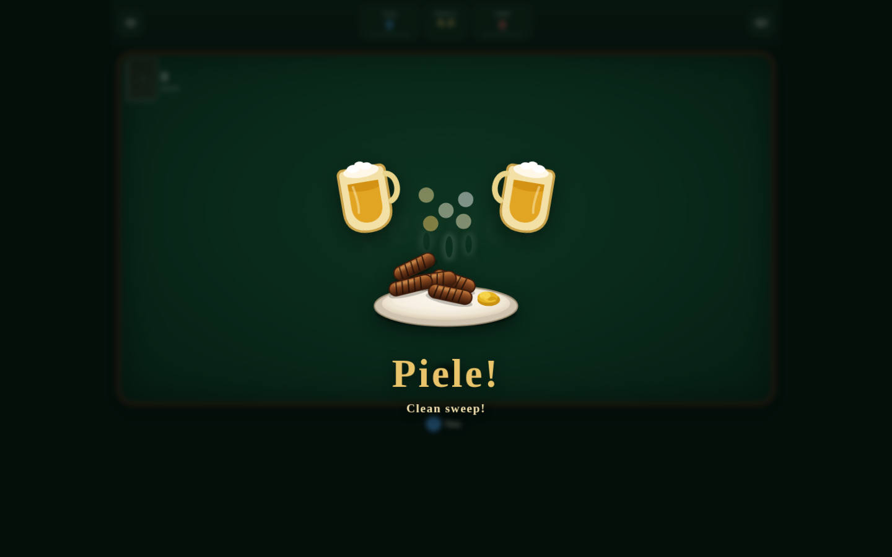
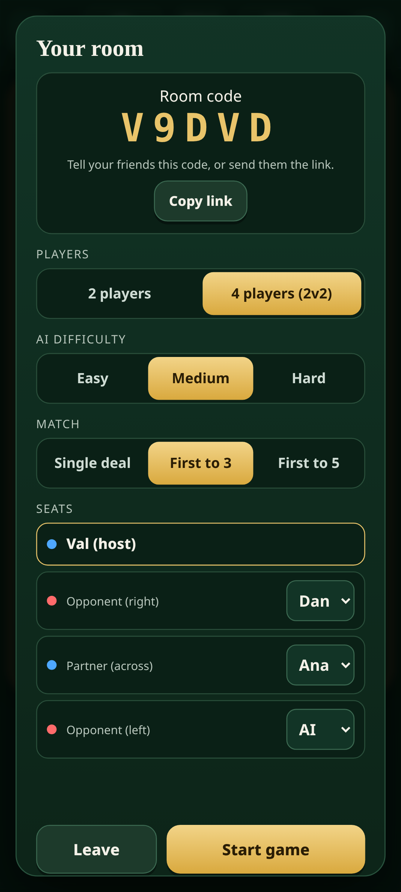
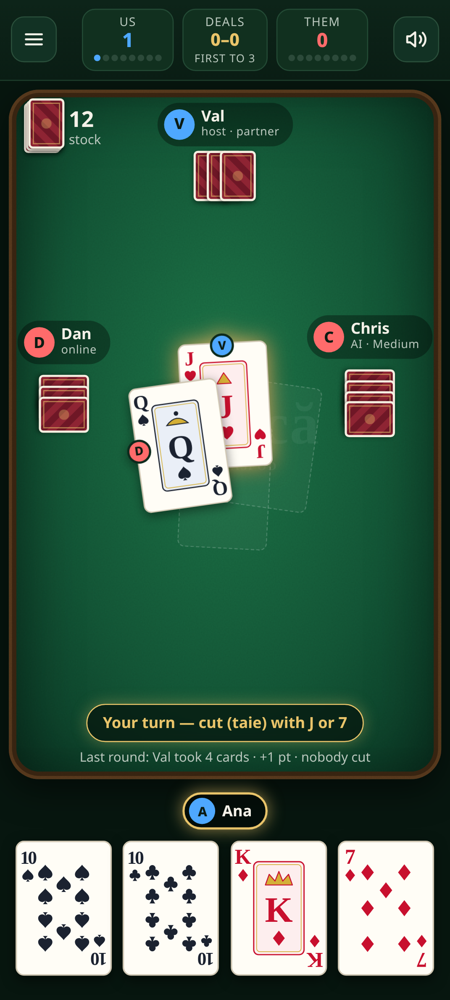

# Șeptică — by Val, VA3FOD

Șeptică is a traditional Romanian trick-taking card game. This is a single-file web version you can play in any browser, on your phone or desktop, including offline — and now **online with friends and family**, each on their own phone.

[Play now on GitHub Pages](https://va3fod.github.io/Septica/)

More apps by Val: [Val apps hub](https://va3fod.github.io/)

## Features

- **2-player** and **4-player teams** versus AI
- **Play online** (new in v2.0): 2 players, or 4 players with 2, 3, or 4 humans — the AI fills any empty seat
- **Easy**, **Medium**, and **Hard** AI
- **English** and **Romanian**
- Rename yourself
- **Continue / Stop** when you can cut
- Last-card auto-play (Continue / Stop is still offered when your last card can cut)
- Match-win cheers
- **Piele** celebration (a clean sweep of every card in the deal): beer cheers plus a plate of mici
- Works **offline** in any browser, on phone and desktop
- A tiny, anonymous **visit counter** (no cookies, no personal data) is shown on the start screen

## How to play

- Open the game in your browser: [https://va3fod.github.io/Septica/](https://va3fod.github.io/Septica/)
- Or download [`index.html`](./index.html) and open it locally — no install, and no internet needed after that.

A copy of the v2.0 build is also attached to the [v2.0 release](https://github.com/va3fod/Septica/releases/tag/v2.0) as `Septica_v2.0.html`.

## Screenshots

2-player, English UI — you can cut, so Continue / Stop is offered:

4-player teams, Romanian UI:

Match-win cheers:

Piele — taking every card in the deal:

## Brief rules

Șeptică uses a 32-card deck (7 through Ace in four suits). Players play cards into a trick.

- You may play any card from your hand.
- A card **cuts** when it matches the rank just played, or when it is a **7**. Sevens cut anything, except when a 7 was led — then only another 7 cuts.
- The **last player to cut** takes the trick.
- If an opponent just cut and you can cut again, you may **Continue** (play another cutting card) or **Stop** and let them take the trick.
- **10s and Aces** are the point cards (1 point each). There are 8 points in a deal.
- The player or team with more points wins the deal. First to the match target wins the match.

## What's new in v2.0 — play online

Play Șeptică with friends and family, each on their own phone or computer.

1. One player taps **Play online → Host a game** and shares the 5-character room code (or the link).
2. Everyone else opens the game, taps **Play online**, enters the code and their name, and taps **Join**.
3. The host picks the seats (2 players, or 4 players in two teams) and taps **Start game**. Empty seats are played by the AI at the host's difficulty.

- Each player sees only their own cards. The host's game runs the rules and the AI and checks every move.
- If someone's connection drops, their seat waits a few seconds and then the AI plays for them. They can come back any time by joining again with the same code and name.
- Works in English and Romanian; each player picks their own language.
- Needs internet. No accounts and no sign-up. The free public PeerJS server only introduces the devices to each other (it sees the room code); the game itself goes directly between the devices, or through PeerJS's free relay when a network blocks direct connections. Some strict mobile networks can still block the connection — Wi‑Fi usually works.
- Single-player is unchanged and still works fully offline.

Online lobby and a game on a phone:

## What's new in v1.9

- **Smarter 4-player partner.** When you already hold the round, your AI partner no longer cuts you. It throws in a point (10 or Ace) for the team, or a low card if it has no point to give, and saves its 7s. It still cuts when the other team is about to take the round. Your partner now plays for you the same way the opponents play for each other.

## What's new in v1.8

- You can now **Stop** on the second-to-last hand, even when your last card could cut. Before, the game played it for you automatically.

## Credit

Made by Val, VA3FOD.

## Source and rights

The source code for this game is not published. This repository contains only the protected v2.0 build and this README. All rights reserved.

Online play uses [PeerJS](https://github.com/peers/peerjs) v1.5.5 (MIT License, © Michelle Bu and Eric Zhang), included unmodified inside the game file.
